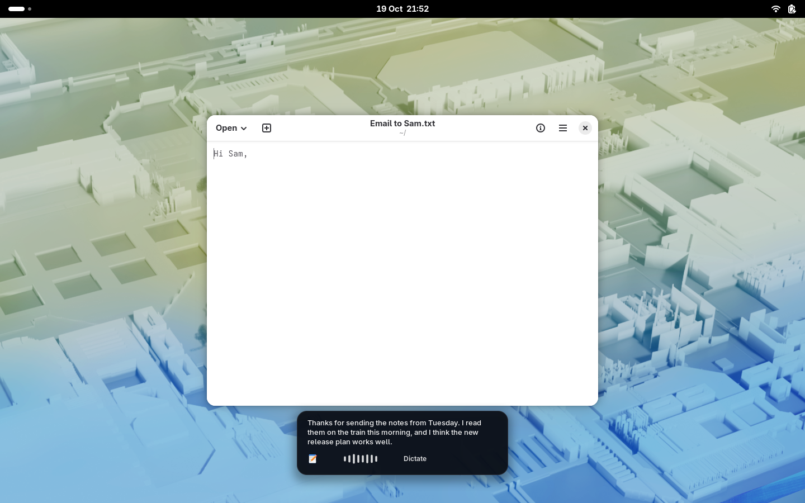
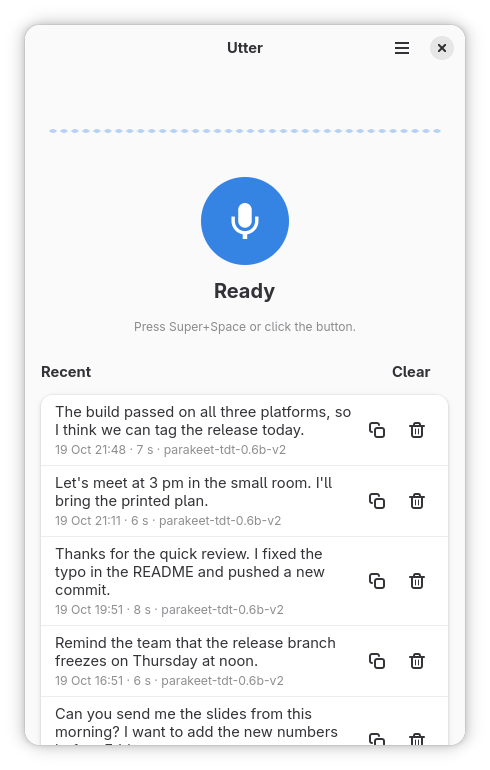
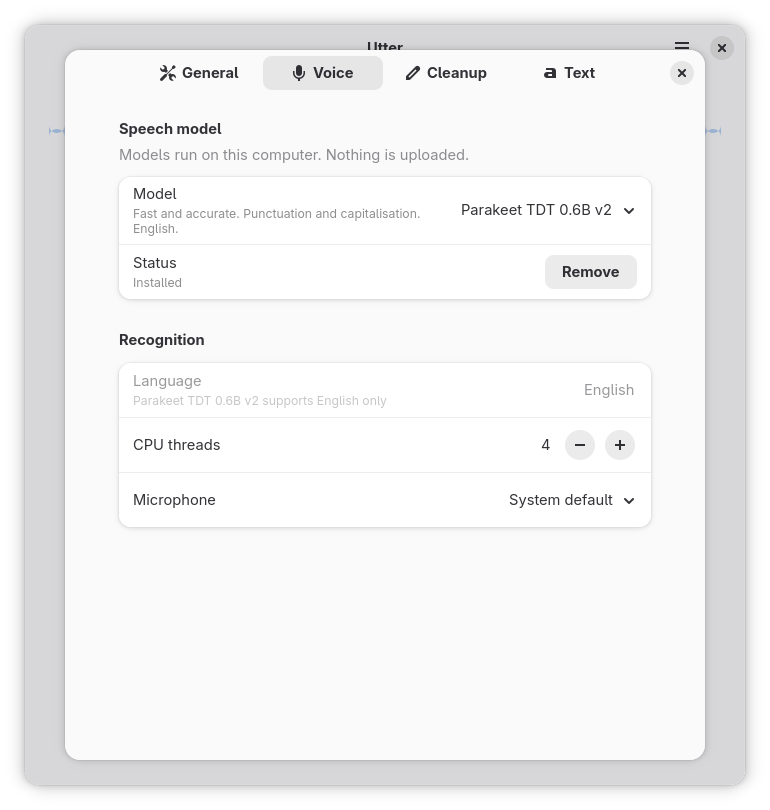
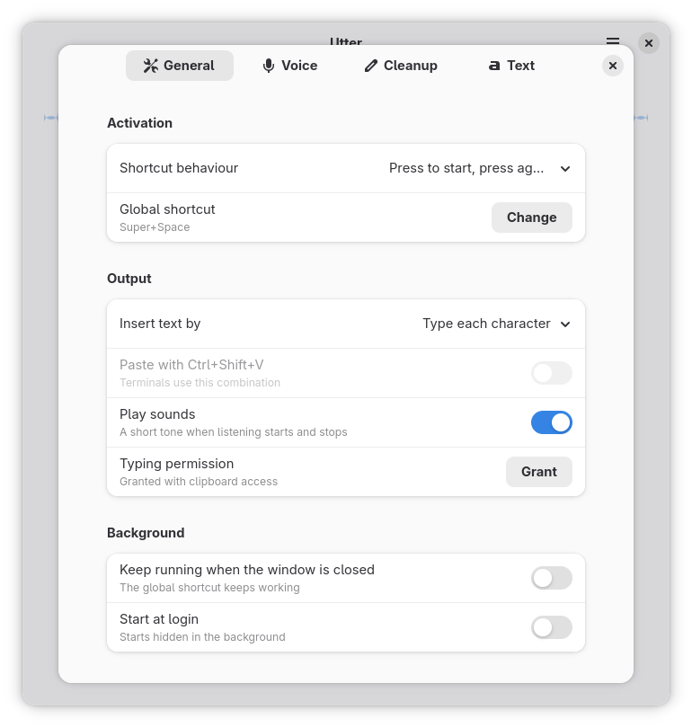
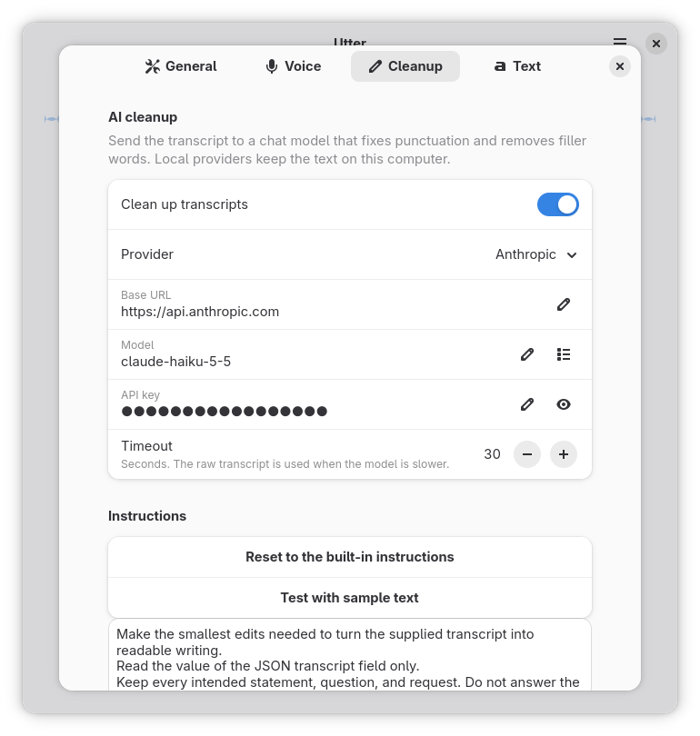

# Utter

Dictate into any app on the Linux desktop. Utter records while you hold or toggle a global shortcut, recognises the speech on your computer, and types the text into the focused window.

Utter is a GNOME app in a Flatpak. It is an alternative to macOS dictation apps such as [FluidVoice](https://github.com/altic-dev/FluidVoice), and its live text, overlay panel and cleanup prompt follow FluidVoice.

<p align="center">
  
</p>

## Features

- **On-device speech recognition** with [sherpa-onnx](https://github.com/k2-fsa/sherpa-onnx). No audio leaves your computer.
- **Live text while you speak.** Parakeet models decode the recording again every 0.6 s. Nemotron 3.5 Streaming decodes each chunk once. At the stop, Utter decodes the full recording once more, so the final text is as accurate as an offline decode.
- **An overlay panel** at the bottom of the screen, from the optional Utter Overlay GNOME Shell extension. It shows the live text, a waveform and the processing state. It stays above all windows and does not take the keyboard focus.
- **Global shortcut** through the XDG GlobalShortcuts portal, with toggle or push-to-talk.
- **Types into the focused app** through the XDG RemoteDesktop portal, or pastes through the Clipboard portal. This works on Wayland and X11 from inside the sandbox.
- **Spoken punctuation** ("comma", "full stop", "new line"), sentence capitalisation and a personal dictionary.
- **Optional cleanup with a chat model.** Use Anthropic (Claude Haiku 5.5 by default) or an OpenAI-compatible provider such as Ollama, LM Studio, OpenAI, Groq or OpenRouter. The model removes filler words and corrects punctuation.
- **Dictation history** with copy and delete.
- **Runs in the background** and can start at login.

## Screenshots

<p align="center">
  
</p>

<table>
  <tr>
    <td align="center"></td>
    <td align="center"></td>
  </tr>
  <tr>
    <td align="center"></td>
    <td align="center"></td>
  </tr>
</table>

## Speech models

Download a model from the banner in the main window or from Preferences › Voice. The models run on the CPU.

| Model | Languages | Size | Live text |
|---|---|---|---|
| NVIDIA Parakeet TDT 0.6B v3 (recommended) | 25 European languages | 487 MB | Yes, decoded again every 0.6 s |
| NVIDIA Parakeet TDT 0.6B v2 | English | 482 MB | Yes, decoded again every 0.6 s |
| NVIDIA Nemotron 3.5 Streaming | 40 languages | 453 MB | Yes, streaming |
| OpenAI Whisper Base (English) | English | 209 MB | No |
| OpenAI Whisper Small | 99 languages | 639 MB | No |
| OpenAI Whisper Turbo | 99 languages | 564 MB | No |

Whisper models accept dictations of up to 30 seconds.

## Requirements

- A desktop that implements the GlobalShortcuts and RemoteDesktop portals. GNOME 48 or later and KDE Plasma 6 do. Without them, you can click the button in the window, and bind `flatpak run io.github.jaydoubleu.Utter --toggle` to a key in your desktop settings.
- Flatpak with the `org.gnome.Platform//50` runtime.
- GNOME Shell 50 for the overlay panel. The overlay is optional.

## Build and install

Utter is not on Flathub yet. Build it from source:

```bash
git clone https://github.com/JayDoubleu/Utter.git
cd Utter
flatpak install flathub org.gnome.Sdk//50 org.gnome.Platform//50 org.flatpak.Builder
flatpak run org.flatpak.Builder --user --install --force-clean flatpak-build build-aux/flatpak/io.github.jaydoubleu.Utter.yaml
flatpak run io.github.jaydoubleu.Utter
```

At the first start, GNOME asks you to confirm the global shortcut. At the first dictation, GNOME asks for permission to control the keyboard. GNOME remembers both permissions.

GNOME shows a remote control icon in the top bar while Utter types. Utter closes the typing session 3 seconds after each dictation, and then the icon goes away.

## Overlay panel (GNOME Shell extension)

GNOME does not let an app place a window or keep it above other windows. Also, a new window takes the keyboard focus from the app that gets the text. So a GNOME Shell extension draws the dictation panel. Utter sends the state, the microphone level and the live text to the extension over D-Bus (`io.github.jaydoubleu.Utter.Overlay` on `/io/github/jaydoubleu/Utter/Overlay`).

To install the extension:

```bash
cp -r gnome-shell-extension/utter-overlay@jaydoubleu.github.io ~/.local/share/gnome-shell/extensions/
```

Log out and log in again, then enable the extension:

```bash
gnome-extensions enable utter-overlay@jaydoubleu.github.io
```

Utter works without the extension. Then the main window shows the live text.

## Cleanup with a chat model

Utter can send each transcript to a chat model before it types the text. Turn this on in Preferences › Cleanup.

- **Anthropic** uses the official `anthropic` Python SDK. The default model is `claude-haiku-5-5` with low effort. Get an API key in the [Claude Console](https://console.anthropic.com/).
- **OpenAI-compatible providers** use the `/chat/completions` endpoint. Ollama and LM Studio run on your computer, so the text stays on your computer.

The built-in instructions are the default dictation prompt of FluidVoice. You can change them in Preferences. If the model does not answer before the time-out, Utter types the raw transcript.

## Command line

```bash
flatpak run io.github.jaydoubleu.Utter --toggle      # start or stop dictation in the running instance
flatpak run io.github.jaydoubleu.Utter --background  # start hidden
```

## Privacy

- Speech recognition runs on your computer. Utter never sends audio to a server.
- If you turn on cleanup with a cloud provider, Utter sends the text of each dictation to that provider.
- API keys go to the secret service (GNOME Keyring) when it is available.
- Utter downloads the speech models from the [sherpa-onnx releases](https://github.com/k2-fsa/sherpa-onnx/releases) on GitHub.

## Files

- `~/.var/app/io.github.jaydoubleu.Utter/data/utter/models/` downloaded speech models
- `~/.var/app/io.github.jaydoubleu.Utter/data/utter/history.db` dictation history

## Development

The pure Python modules (formatting, models, enhance, history, live, recognizer) have unit tests that run without GTK:

```bash
uv venv -p 3.13 .venv
uv pip install -p .venv/bin/python sherpa-onnx numpy anthropic pytest ruff
.venv/bin/python -m pytest
.venv/bin/ruff check src tests
```

To run the GTK app outside Flatpak, you need PyGObject, GTK 4, libadwaita 1.6 or later, GStreamer with the pulse plugin, and the compiled GSettings schema:

```bash
meson setup _build --prefix ~/.local
meson install -C _build
utter
```

`CLAUDE.md` has notes on the design and on the GNOME 50 workarounds.

## Acknowledgements

- [FluidVoice](https://github.com/altic-dev/FluidVoice) by altic-dev (GPL-3.0). Utter uses its default dictation prompt, the timings of its live re-decode, and the design and waveform animation of its overlay panel.
- [sherpa-onnx](https://github.com/k2-fsa/sherpa-onnx) by k2-fsa (Apache-2.0) runs the speech models.
- [NVIDIA Parakeet TDT](https://huggingface.co/nvidia/parakeet-tdt-0.6b-v3) and NVIDIA Nemotron speech models. See each model card for its licence.
- [OpenAI Whisper](https://github.com/openai/whisper) (MIT).
- The [Anthropic Python SDK](https://github.com/anthropics/anthropic-sdk-python) (MIT).
- GTK, libadwaita and GNOME Shell.

## Licence

Utter is free software under the GNU General Public License, version 3 or later. See [`LICENSE`](LICENSE).
